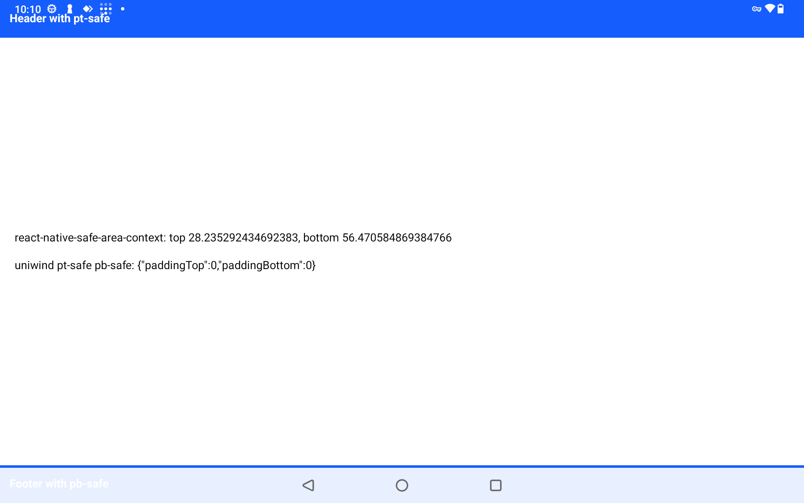

# Uniwind Pro: Android safe area insets stay 0 after a start with the screen off

Minimal repro for a Uniwind Pro 1.9.1 bug on Android: when the app starts while the screen is off, `pt-safe` and `pb-safe` resolve to 0 until the app restarts. `react-native-safe-area-context` reports the correct insets at the same time.

Expo SDK 57, React Native 0.86.3, new architecture, edge-to-edge. The app has one screen with a `pt-safe` header and a `pb-safe` footer. It shows both values on screen and logs them every 5 s:

```
DEBUG insets {"safeAreaContext":{...},"uniwind":{"paddingTop":...,"paddingBottom":...}}
```

## Setup

Uniwind Pro needs a license. `bun install` downloads the Pro package in its postinstall script ([installation docs](https://docs.uniwind.dev/pro/installation)).

```sh
bun install
npx expo run:android
```

## Steps

A device with 3-button navigation makes the bottom inset easy to see. We tested on a device without a lock screen.

```sh
PKG=com.example.uniwindsafearearepro

adb shell am force-stop $PKG
adb shell input keyevent KEYCODE_SLEEP
sleep 30
adb shell am start -n $PKG/.MainActivity
# wait about 20 s, so the JS bundle loads from Metro while the screen is off
adb shell input keyevent KEYCODE_WAKEUP
adb logcat -s ReactNativeJS | grep "DEBUG insets"
```

Expected: `uniwind` matches `safeAreaContext`, as it does when the app starts with the screen on.

Actual: `uniwind` is `{"paddingTop":0,"paddingBottom":0}` and the header text is under the status bar. It stays like this after a background and foreground cycle. Only an app restart fixes it.


